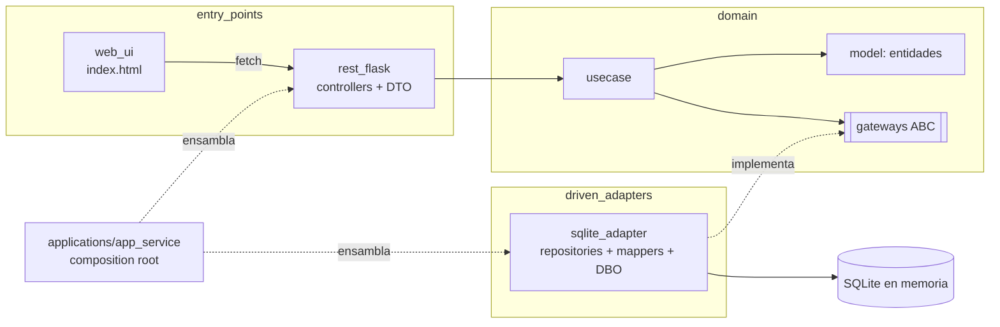

# Arquitectura (Puertos y Adaptadores)

Regla: las flechas de dependencia del código apuntan hacia `domain`. El dominio no conoce ni Flask ni infraestructura; la composición se hace desde `applications`.
